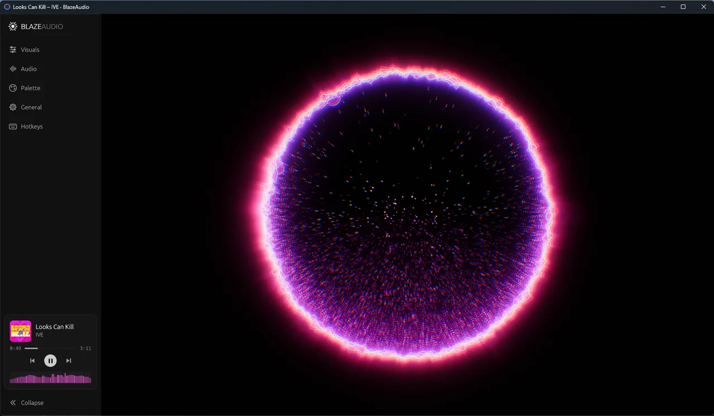
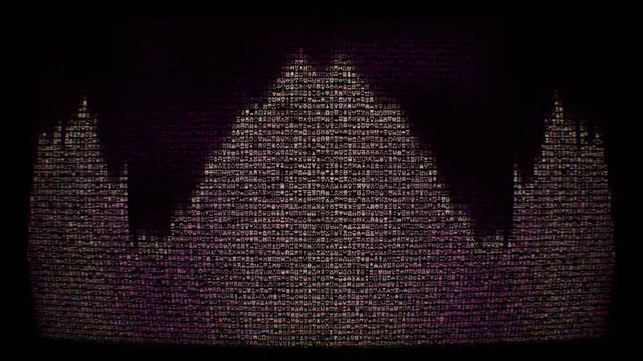
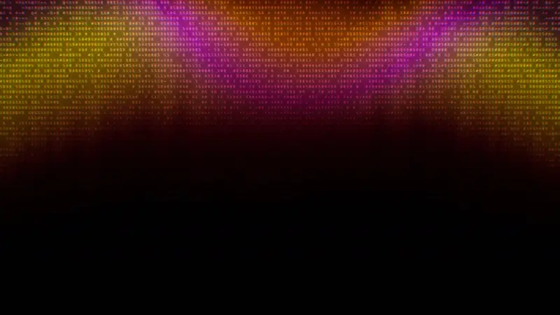
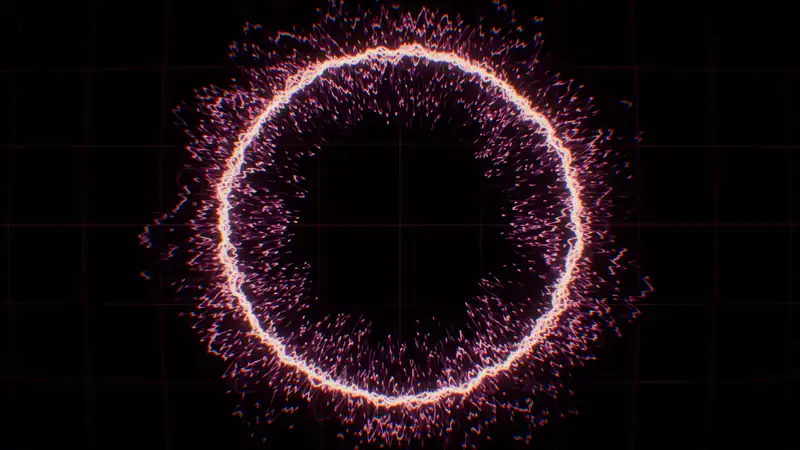
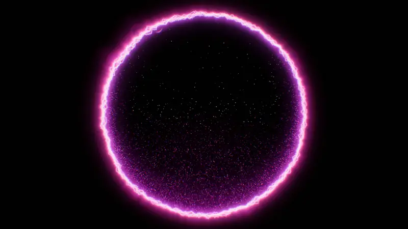

# BlazeAudio

An HDR music visualizer for Windows. It listens to whatever your PC is playing (Spotify, a browser, a game, anything) and turns it into audio-reactive visuals. It picks up the song title and album art, takes its colours from the cover, and runs in a window or fullscreen.

Everything ships as one portable `blazeaudio.exe`. There's nothing to install and no account to sign into. The only time it goes online is to check GitHub for a new version, which you can turn off.



## Requirements

- Windows 10 (version 1809 or later) or 11
- A DirectX 12 capable GPU

## Download

1. Download **[blazeaudio.exe](https://github.com/blaze280599/BlazeAudio/releases/latest/download/blazeaudio.exe)** from the [latest release](https://github.com/blaze280599/BlazeAudio/releases/latest).
2. Put it in a folder you can write to, such as Documents, your Desktop or a USB stick. Avoid `Program Files`: the app updates by replacing its own exe, which it can't do there.
3. Double-click it. The exe isn't code-signed, so the first time Windows SmartScreen may say it "protected your PC". Click **More info**, then **Run anyway**. Updates the app installs itself don't ask again.

To check the download, compare its hash with `blazeaudio.exe.sha256` on the release page. In PowerShell, run `Get-FileHash blazeaudio.exe` in the folder you saved it to.

**Updates:** by default the app checks GitHub when it starts and installs a new version in the background, which runs from the next start. **General → Updates** can switch that to just notifying you, or off.

**Uninstalling:** delete `blazeaudio.exe`, and `%APPDATA%\BlazeAudio` if you also want your settings gone.

## Getting started

1. Run `blazeaudio.exe`.
2. Play music. BlazeAudio visualizes everything your default output device plays.
3. If the music app reports what's playing to Windows (Spotify does), you'll see the title, artist and cover, and the visuals take on the cover's colours.

Settings live in the sidebar on the left. Press `F1` to show or hide it.

## Scenes

<table>
  <tr>
    <td width="50%"><br><b>1 · Faulty Terminal</b></td>
    <td width="50%"><br><b>2 · Gradient ASCII</b></td>
  </tr>
  <tr>
    <td width="50%"><br><b>3 · Phosphor Scope</b> (polar mode)</td>
    <td width="50%"><br><b>4 · Crystalized Ball</b></td>
  </tr>
</table>

Recorded live while playing music; the colours come from the track's album art.

| | Scene | What it looks like |
|---|---|---|
| `1` | **Faulty Terminal** | A flickering CRT full of glyphs. The columns form a spectrum analyzer, highs make the glyphs churn, and beats tear rows sideways with an RGB-split glitch. |
| `2` | **Gradient ASCII** | A soft light seen through a grid of characters, which get denser where it's brighter. Four light shapes. The edge follows the spectrum, and beats send rings of scrambled characters outward. |
| `3` | **Phosphor Scope** | A vector oscilloscope on curved CRT glass, tracing the live waveform with a glowing afterglow, as a classic sweep or wrapped around a circle. |
| `4` | **Crystalized Ball** | A glass sphere ringed with crackling electric strands, full of glowing dust. Beats surge the rim, fire sparks and toss the dust like a snow globe, and the spectrum shapes the flares around the rim. |

Switch with the number keys, `S` for the next scene, or the buttons in **Visuals**. **Auto-switch** can move on by itself on each new track or on a timer.

## Features

- **Album-art colours**: on each track change the visuals fade to colours taken from the cover. Five built-in palettes cover the times nothing is playing.
- **Now playing**: a card with the cover and title appears on each track change (`T` shows it again). The sidebar has play/pause, skip and a progress bar.
- **Seeking**: hover the visuals for a wide timeline you can drag, click or scroll. `Left` / `Right` jump 5 s.
- **Volume**: hovering also shows a volume bar for the Windows output volume. `Up` / `Down` change it and `M` mutes.
- **Window modes**: windowed with the sidebar, or borderless fullscreen (`F11`) for just the visuals.
- **Look controls**: bloom, exposure, chromatic aberration, film grain, vignette and per-scene options, each resettable on its own. **Randomize** rolls a new look, **Undo** steps back and **Reset** restores the defaults.
- **Lightweight**: about 0.1% CPU when idle and under 1% while playing, with around 20 MB of memory. It slows down when nothing is playing and stops rendering when hidden.
- **Updates itself**: on launch it checks GitHub for a new release. By default it downloads it in the background and swaps it in, so the next start runs the new version (or click **Restart now** under General). Set **Updates** to **Notify** to just be told, or **Off** to never go online unless you click **Check now**.
- **Remembers you**: settings, window position and size persist between runs. Only one copy runs at a time.

## Controls

| Key | Action |
|-----|--------|
| `F1` / `Tab` | Show / hide the sidebar |
| `F11` / `F` / `Alt+Enter` / double-click | Fullscreen |
| `1` – `4` | Faulty Terminal / Gradient ASCII / Phosphor Scope / Crystalized Ball |
| `S` | Next scene |
| `Space` | Play / pause |
| `N` / `P` | Next / previous track |
| `Left` / `Right` | Seek 5 s back / forward |
| `T` | Show the now-playing card |
| `Up` / `Down` | Volume up / down |
| `M` | Mute / unmute |
| `F3` | Performance stats |
| `Esc` | Close the drawer, then the sidebar, then leave fullscreen |

## Settings

The sidebar has five sections:

- **Visuals**: scene, auto-switch, the scene's own options, and the shared look effects
- **Audio**: sensitivity, how fast bars rise and fall, beat sensitivity
- **Palette**: album colours on or off, and the fallback palette
- **General**: window and startup mode, theme (Dark, OLED black, Light), on-scene extras, updates
- **Hotkeys**: the full key list

A changed setting shows a reset button next to it; double-clicking its label also resets it. Settings are saved to `%APPDATA%\BlazeAudio\settings.json`.

## Building from source

You need Rust (stable, MSVC toolchain) and the Visual Studio C++ build tools.

```bash
cargo build --release
```

The output is `target\release\blazeaudio.exe`, statically linked, so no VC++ redistributable is needed.

Releases are built by GitHub Actions: bump `version` in `Cargo.toml`, commit, then push a matching tag (`git tag v1.2.0 && git push origin v1.2.0`). The workflow builds the exe and publishes it with its SHA-256 checksum, which is what the in-app updater downloads.

To check that everything works without opening a window, run the self-test. It plays a synthetic track through the analyzer, renders every scene to PNGs in `out/`, and writes a report:

```bash
target/release/blazeaudio.exe --snapshot out
```

## How it's built

BlazeAudio is written in Rust:

- audio capture is WASAPI loopback through `cpal`, with an FFT and beat and tempo detection on a capture thread
- now-playing info comes from the Windows media session API
- rendering is `wgpu` on DirectX 12 with HDR bloom and ACES tonemapping
- the UI is `egui`

Each scene is a self-contained module, so new scenes can be added without touching the rest of the app.

**Working on the code?** [AGENTS.md](AGENTS.md) is the full technical guide: architecture, threading, the render pipeline, conventions, and step-by-step recipes for adding scenes, settings, hotkeys and UI. It's written so AI coding agents like Claude can follow it, and it's just as useful for people.

## Credits

Faulty Terminal and Gradient ASCII are inspired by the [React Bits](https://reactbits.dev) backgrounds of the same names. Faulty Terminal is written from scratch for wgpu/WGSL, and Gradient ASCII is ported from the React Bits WebGL2 shader. Both are driven by audio instead of the cursor. The glyphs use Hack, the monospace font bundled with egui. The volume slider is ported from the React Bits WakeSlider.
